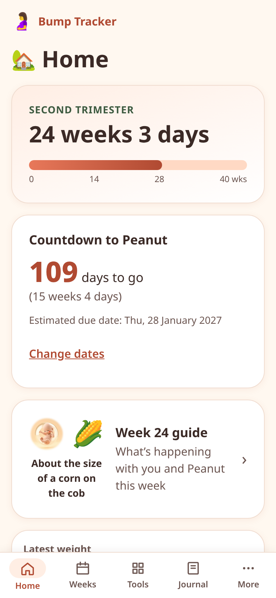
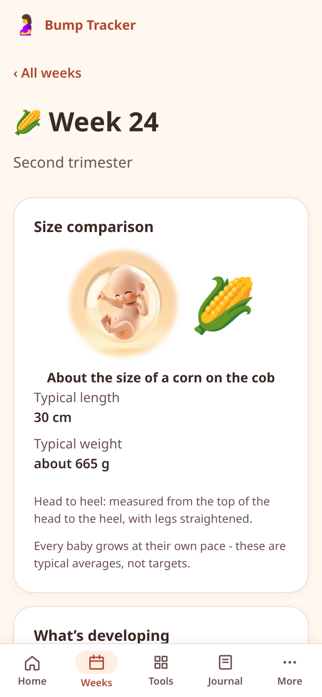
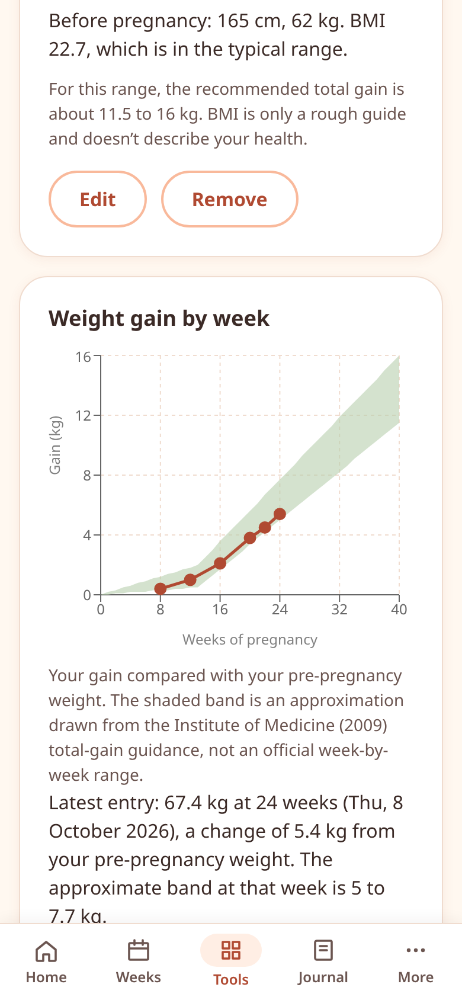
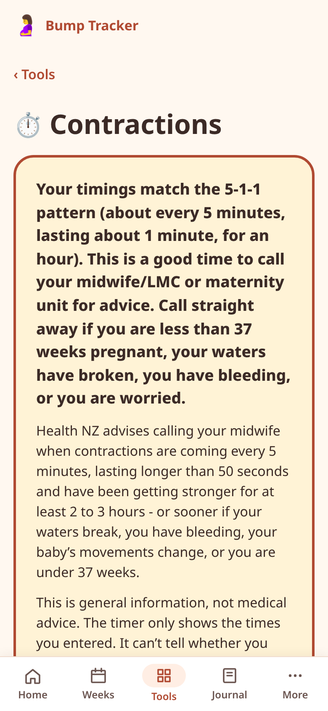

# Hey Baby

A privacy-first pregnancy tracker demo for Aotearoa New Zealand (Vite + React + TypeScript, installable PWA). All data stays in your browser: no backend for your data, no third-party trackers, only an anonymous daily count you can turn off. Optional sync stores an end-to-end encrypted copy in the user's own Google Drive; we store nothing.

> General information only, not medical advice. Contact your midwife/LMC with any concerns, or call 111 in an emergency (NZ).

<p>
  
  
  
  
</p>

More screens are in [`docs/screenshots/`](docs/screenshots/) (390 px mobile viewport, demo data).

## Features

- **Due date calculator / onboarding**: from last menstrual period (Naegele, +280 days) or a dating scan (date + gestational age). Home shows week + day, trimester, progress and countdown.
- **Week-by-week guide (weeks 4-40)**: what's developing, what you might notice, typical length and weight, and a size comparison to an everyday object, with a stylised baby illustration.
- **Weight tracker**: weekly log and chart; with optional *before pregnancy* height/weight it shades the IOM 2009 recommended gain range for your pre-pregnancy BMI (singleton pregnancies).
- **Contraction timer**: big start/stop button, duration/interval history, last-hour averages, 5-1-1 alert banner, screen wake lock while timing.
- **Scans & appointments**: log with notes and measurements; estimated fetal weight plotted against the WHO fetal growth chart median and 10th-90th percentile band.
- **Baby movements (kick counter)**: from 28 weeks, with Health NZ / NHS guidance that any reduction in movements means calling your midwife straight away.
- **Bump photo timeline**: one photo per week, stored in IndexedDB (downscaled, metadata stripped), with slideshow.
- **Symptom & mood journal** with a "mention to midwife" flag.
- **Hospital bag and birth plan checklists** (editable).
- **Baby name shortlist**: your own names with an optional note; star favourites to keep them at the top. No name database, nothing shared.
- **Food safety**: New Zealand Food Safety's (MPI) pregnancy food table, searchable: OK to eat, take care, only if cooked, don't eat, plus fish servings for mercury.
- **Supplements**: tick off folic acid, iodine or anything your care team suggested, see the last 7 days, and add a daily reminder to your phone's calendar (a repeating .ics event made on the device). Health NZ guidance on folic acid and iodine alongside.
- **Blood pressure and glucose logs**: for people whose care team asked them to check at home. Readings, a chart and the print summary. The app sets no targets and doesn't interpret readings: it only flags readings above upper limits the user enters from their own team, and then points to their care team.
- **Questions for my midwife**: a running list from the Journal; tick them off as you ask, and open ones go on the print summary.
- **Dark mode**: follows the device, or choose Light/Dark in Settings (per device). Every colour pair meets WCAG AA in both themes; charts follow the theme.
- **Partner summary**: copyable text or a read-only snapshot link (selected fields encoded in the URL hash; nothing is uploaded; it does not update).
- **Printable appointment summary** (print stylesheet / Save as PDF).
- **NZ antenatal timeline**: the usual checks, tests and vaccines from Health NZ (LMC, first bloods, optional screening, whooping cough and flu vaccines, anatomy scan, glucose test) placed on your own dates, with a "Coming up" card on Home and a calendar file (.ics) made on the device. Upcoming appointments go in by type and date only, never notes.
- **When to call**: the sourced warning signs in one place, with one-tap calling for your own midwife/LMC, birthing unit and GP (saved in Settings), Healthline and 111. Call buttons also appear on Home, the contraction timer and the kick counter.
- **Baby mode**: once "Baby's here" is set, the tabs become Home, Baby log, Help, Journal and More. Home shows the baby's age, an "In an emergency" card, the next immunisations, a weekly "How are you going?" check-in for you (no scoring; "Up and down" or "Struggling" brings up support lines) and safe sleep (Starship).
- **Help tab** (baby mode, works offline): Call 111 first, then baby CPR (KidsHealth) and baby choking (Health NZ) word for word, when to get help (KidsHealth), your own health after the birth (Health NZ), and support lines (PADA: 1737, Lifeline, Samaritans, PlunketLine).
- **Immunisations**: due dates from the birth date and the vaccines at each visit (Health NZ National Immunisation Schedule), done ticks, and a calendar file of due dates.
- **Baby log**: once "Baby's here" is set. Breastfeeds with a timer (switch sides, pause, time on each side), bottles (ml, formula, breast milk or mixed), nappies (wet, dirty, both, dry), sleep, pumping (timer and ml per side), solids, medicine, temperature, activities (tummy time, bath, story, skin-to-skin, outdoors) and growth. Timers keep running when the app is closed. Edit any entry, add earlier ones, notes, Undo, and a "who logged it" name per phone. Day-by-day history, a Trends page (7 or 14 days of sleep, feeds and nappies as charts and a table, daily averages only, a growth chart) and a CSV export; the print summary adds the last 7 days. Home shows what's happening now; Android home-screen shortcuts open the log. Records only; no targets.
- **Two caregivers**: with sync on, two phones can both log; the baby log merges entry by entry (deletions are remembered for 60 days) instead of asking which copy to keep. Design for pairing without an account: `docs/FAMILY-SHARING.md`.
- **Firsts**: a keepsake list of baby moments with a date and a note. No ages, nothing is "due".
- **Share with my midwife** (Journal): tick journal entries (flagged ones are ticked already), open questions, the last 14 days of BP or glucose with your own limits, and in baby mode the last 7 days of the baby log. See the exact text, then share it from your phone, copy it, or print or save it as a PDF. Nothing goes through us.
- **When the pregnancy ends**: "Baby's here" turns Home into a keepsake page with birth details and PlunketLine. "My pregnancy has ended" stops all pregnancy updates and shows support (1737, Sands NZ, Miscarriage Support). Both keep your data and can be undone in Settings.
- **Contact us** (More): feedback, feature requests or problems. Opens our Google Form with your answers pre-filled; you press Submit there. Anonymous unless you add an email; app info is visible and removable. Email (dons-bot@agentmail.to) is the fallback. Nothing is sent by the app itself.
- **Your data**: JSON backup export/import (optionally with photos) and "delete all my data".

Content sources are listed in the app (More > Sources) and in [docs/SOURCES.md](docs/SOURCES.md).

## Run it locally

```sh
npm install && npm run dev
```

Then open the URL Vite prints (usually http://localhost:5173). Requires Node 20+.

## Scripts

```sh
npm run dev       # dev server
npm run build     # type-check + production build to dist/
npm run preview   # serve dist/ (service worker is registered here, not in dev)
npm test          # vitest (runs in Pacific/Auckland time, see vite.config.ts)
npm run check:offline  # headless offline check of dist/ (needs: npm i --no-save playwright && npx playwright install chromium)
npm run deploy    # deploy dist/ to Cloudflare (Workers Builds runs this; needs Cloudflare login if run by hand)
```

`npm run build` also fills `dist/sw.js` with the precache list (`scripts/sw-precache.mjs`). Pushes to `main` deploy to Cloudflare Workers automatically (`wrangler.jsonc`, `public/_headers`). [docs/DEPLOY-NOTES.md](docs/DEPLOY-NOTES.md) has the one-time dashboard setup, the security headers and the caching rules.

> Note: with npm 9, adding or upgrading packages can crash with `Cannot read properties of null (reading 'edgesOut')`.
> This is an npm 9 bug, triggered by Vitest 4's optional peer dependencies. Use `npx npm@10 install <pkg>` for that.
> A plain `npm install` from the lockfile works with npm 9.

## Limitations

- Demo project: content is general information, paraphrased from the sources listed, and has not been clinically reviewed.
- Without sync, data lives only in this browser; clearing site data deletes it. Use the JSON backup or turn on sync.
- Sync (Google Drive) needs a Google account and the recovery code shown at setup. Photos aren't synced.
- The partner link is a static snapshot; anyone with the link can read the fields you chose.
- Baby illustrations are AI-generated stylised art (not medical images). Seven stages exist (weeks 6, 8, 12, 16, 20, 24, 28); weeks 28-40 reuse the week 28 image.
- How this was built: see [docs/claude-code-log.md](docs/claude-code-log.md).

## Structure

```
src/
  app/          App shell, hash router (router.tsx), route table (routes.tsx)
  components/   Shared UI: Page, HealthDisclaimer, PlaceholderPage, BottomNav, FormField, HubList, ProgressBar, Icon
  features/     One folder per screen (home, onboarding, settings, weeks, tools, weight, contractions,
                scans, kicks, photos, checklists, journal, more, partner, print, data, sources, about)
  lib/          Pure logic + hooks
    dates.ts        LocalDate (YYYY-MM-DD) arithmetic, timezone/DST-safe
    pregnancy.ts    Due date (LMP / scan), gestational age, trimester, countdown, validation
    profile.ts      Onboarding profile type + validator
    storage.ts      Versioned localStorage (keys `bt:v1:<name>`), validated reads
    useStoredState  React hook over storage (syncs across components and tabs)
    photoStore.ts   IndexedDB photo blobs (raw API)
    route.ts        Path normalising/matching for the router
  data/         Content: weeks.ts (weeks 4-40), sources.ts, checklists.ts
  styles/       tokens.css (CSS variables), base, layout, components
public/
  manifest.webmanifest, sw.js (cache-first shell, versioned cache), icons/, images/baby/*.webp
```

### Adding a feature screen
1. Build it in `src/features/<feature>/`.
2. Register its route in `src/app/routes.tsx` (and add a hub link in Tools/More if needed).
3. Persist data with `useStoredState(name, default, validator)`, and add the key to `STORAGE_KEYS`.

### Security notes
- No `dangerouslySetInnerHTML`. All stored and imported data passes through validators in `src/lib`.
- The production build injects a strict Content-Security-Policy meta tag (`vite.config.ts`). React `style={...}` props are fine because they set styles through the CSSOM. If a library injects `<style>` tags, it will need a `style-src` change.
